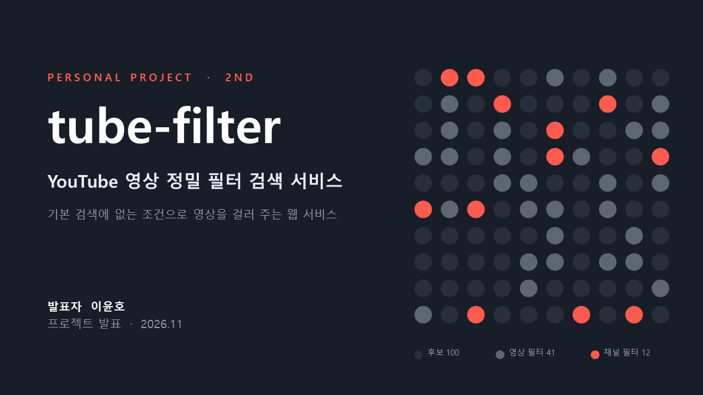
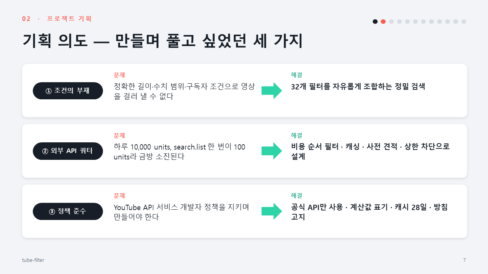
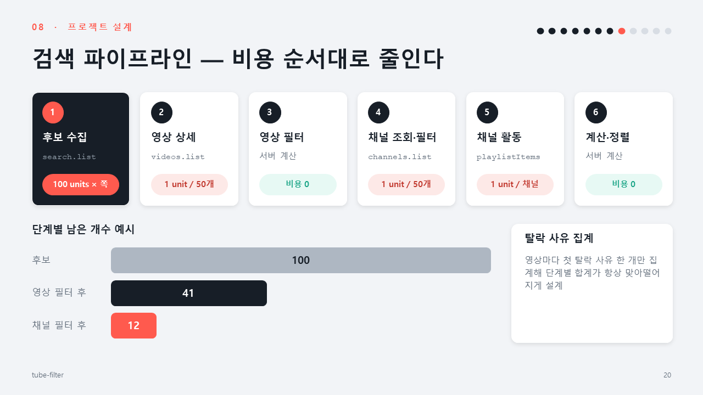
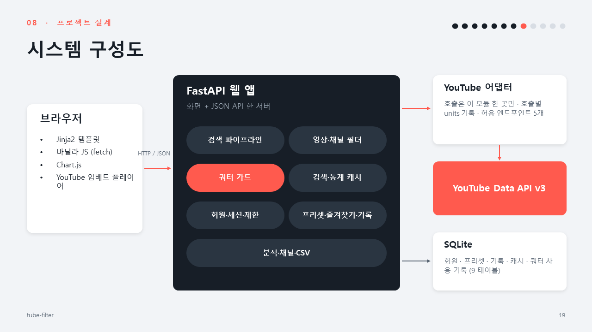
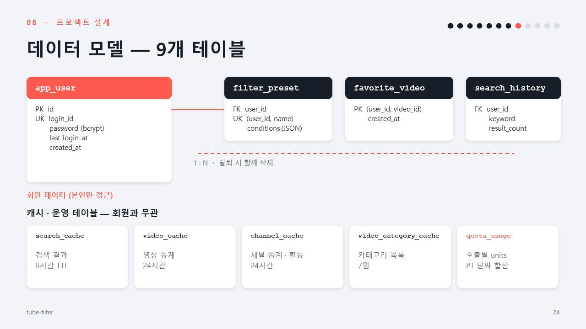
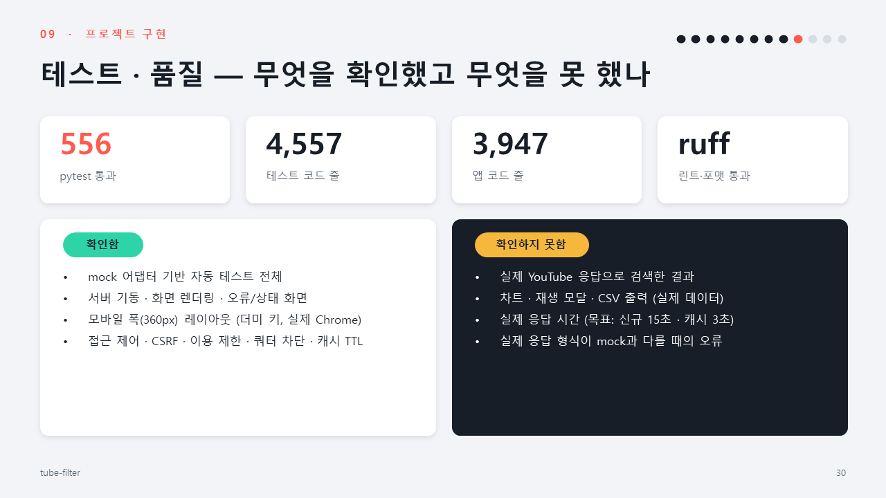

# tube-filter 문서



[tube-filter](https://github.com/ho8566z/tube-filter) 프로젝트의 명세서와 발표 자료를 모아 둔 문서 저장소입니다. (2차 개인 프로젝트, 2026.11.10 ~ 11.13)

코드는 [tube-filter](https://github.com/ho8566z/tube-filter) 저장소에 있고, 이 저장소에는 구현 전에 정한 기획·설계 문서와 발표 자료만 둡니다.

## 프로젝트 요약

YouTube 기본 검색에 없는 조건(정확한 영상 길이, 조회수·좋아요 범위, 구독자 수 범위, 구독자 대비 조회수 %, 태그, 업로드 요일·시간대, 채널 업로드 빈도 등)으로 영상을 걸러 주는 정밀 필터 검색 서비스입니다.



- **핵심 기능**: 필터 32개, 검색 파이프라인, 쿼터 관리, 분석(요약·산점도·히트맵), CSV 내보내기
- **기술 스택**: Python 3.12, FastAPI, SQLAlchemy·Alembic, Jinja2, 바닐라 JS, Chart.js, YouTube Data API v3
- **포트폴리오 관점**: 외부 API 쿼터(하루 10,000 units)를 설계로 푸는 과정(비용 순서대로 필터 적용, 캐싱, 사전 견적)
- **작업 방식**: 기획·문서는 직접, 문서 작성은 Claude, 구현은 Codex가 맡는 명세서 중심 협업

## 폴더 구성

```
images/
  ppt/                             README에 넣은 발표 자료 슬라이드
output/
  tube-filter 명세서 목록.xlsx      명세서 전체(시트 15개)
  tube-filter 명세서 목록_백업_20261110.xlsx
ppt_output/
  tube-filter 발표.pptx            발표 자료(34장)
  tube-filter.pdf                  발표 자료 PDF
  tube-filter 발표/                슬라이드 이미지(슬라이드1~34.PNG)
```

## 명세서 (output/tube-filter 명세서 목록.xlsx)

| 시트 | 내용 |
| --- | --- |
| 프로젝트 산출물 가이드 | 제출해야 할 산출물 항목과 작성 상태 |
| WBS | 4일 일정(문서 → 구현 → PPT → 마무리)과 작업별 상태 |
| 프로젝트 개요 | 목표, 원천·가공 데이터, 기술 스택, 알려진 한계 |
| 요구 명세서 | 구분별 요구사항(ID, 우선순위, 수용 기준) |
| 기능 목록 | 기능 ID, 설명, 구현 위치(`app/...`) |
| 기능 명세서 | 입력, 처리 순서, 업무 규칙, 예외 |
| 필터 명세서 | 필터별 조건, 적용 위치, 쿼터 비용 |
| API 명세서 | `/api/v1` 경로, 메서드, 요청·응답, 오류 코드 |
| 화면 기능 명세서 | 화면별 영역·요소·동작 |
| 테이블 명세서 | 테이블과 컬럼, 관계 |
| 설정·규약 | 환경변수, 쿼터 비용, 응답 형식 등 공통 기준 |
| 정책 준수 체크 | YouTube API 서비스 개발자 정책 대응 |
| 2순위 기능 | 핵심 기능 이후로 미룬 기능 |
| 구현 반영 사항 | 구현하며 명세와 달라진 점 |
| 트러블슈팅 | 개발 중 만난 문제와 해결 |

같은 내용을 시트별 Markdown으로 변환한 것은 [tube-filter/docs/spec](https://github.com/ho8566z/tube-filter/tree/main/docs/spec)에 있습니다. 내용이 다르면 엑셀 원본이 기준입니다.

## 검색 파이프라인



조건 검증 → 쿼터 견적 → 캐시 확인 → 후보 수집 → 영상 상세 → 영상 필터 → 채널 조회·필터 → 지표 계산 → 정렬·집계 순서로, 비용이 낮은 필터부터 적용해 API 호출을 줄입니다.

## 시스템 구성



YouTube API 호출은 어댑터 한 곳만 거치고, 테스트는 mock 어댑터로 합니다.

## 데이터 모델



9개 테이블의 컬럼과 관계는 명세서의 `테이블 명세서` 시트에 있습니다.

## 테스트와 한계



- mock 어댑터 기반 pytest 556개와 ruff는 통과했습니다.
- **YouTube Data API 키를 발급하지 못해 실제 데이터로는 시연·검증하지 못했습니다.** 실제 응답으로 검색한 결과, 응답 시간, 응답 형식 차이는 확인하지 못했습니다.

## 발표 자료

전체 발표 자료(34장)는 `ppt_output/tube-filter 발표.pptx`와 `ppt_output/tube-filter.pdf`에 있습니다. 이 README에는 설명에 필요한 슬라이드만 해당 섹션에 넣었습니다.

## 작성자

이윤호 (개인 프로젝트)
